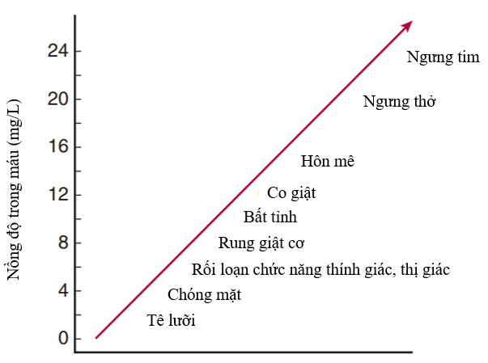

# Lidocaine

## Nội dung

- Lidocaine là thuốc gây tê, chống loạn nhịp tim nhóm 1B.
- Cơ chế: Lidocaine gắn với một loại receptor đặc biệt ở trong kênh Na+ màng tế bào sợi trục thần kinh, mô có hệ dẫn truyền (tim, não) → Khoá kênh và gây bất hoạt kênh Na+ → Ức chế dẫn truyền sợi trục thần kinh: sợi myelin và sợi không có bao myelin → Mất cảm giác đau và nhiệt độ.

## Hình

## Tài liệu tham khảo

- Goldfrank’s Toxicologic Emergencies, 9th edition, trang 970.
