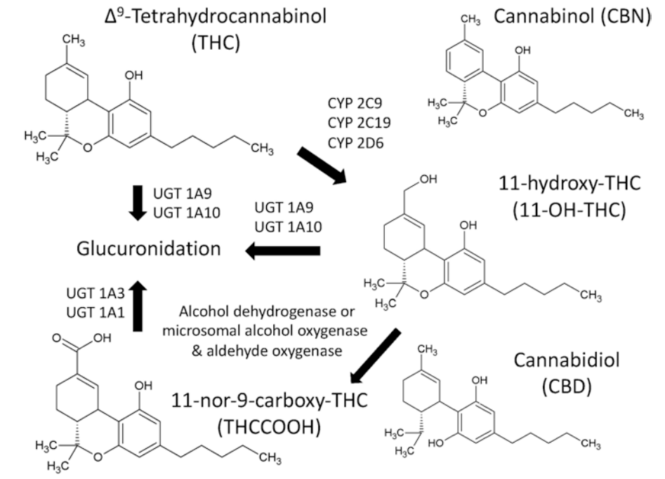

# Tetrahydrocannabinol

## Nội dung

- Tetrahydrocannabinol (THC) là một trong những thành phần chính của cây cần sa.
- Cơ chế: nhóm THC gắn vào thụ thể cannabinoid ở thần kinh trung ương và ở ngoại vi của đầu tận cùng synap trước → đến giảm nồng độ adenosine monophosphate vòng trong tế bào (cAMP), giảm hoạt động của các kênh Ca2+ → giảm giải phóng chất dẫn truyền thần kinh GABA → ức chế thần kinh
- Các chất chuyển hóa chính theo sơ đồ dưới đây:
- Y văn ghi nhận một trường hợp hôn mê, vã mồ hôi, cứng cơ với nồng độ trong máu là 0,18 mg/L.

## Hình

## Tài liệu tham khảo

- Randall C. Baselt (2008). Disposition of Toxic Drugs and Chemicals in Man, 8th edition, Biomedical Publications, California, pp.1513-1518.
- Schulz, M., Schmoldt, A., Andresen-Streichert, H., & Iwersen-Bergmann, S. (2020). Revisited: Therapeutic and toxic blood concentrations of more than 1100 drugs and other xenobiotics. Critical care (London, England), 24(1), 195.
- Lewis S. Nelson, Mary Ann Howland, Neal A. Lewin, Silas W. Smith, Lewis R. Goldfrank, and Robert S. Hoffman (2019), Goldfrank’s Toxicologic Emergencies, 11th ed, McGraw-Hill Education
